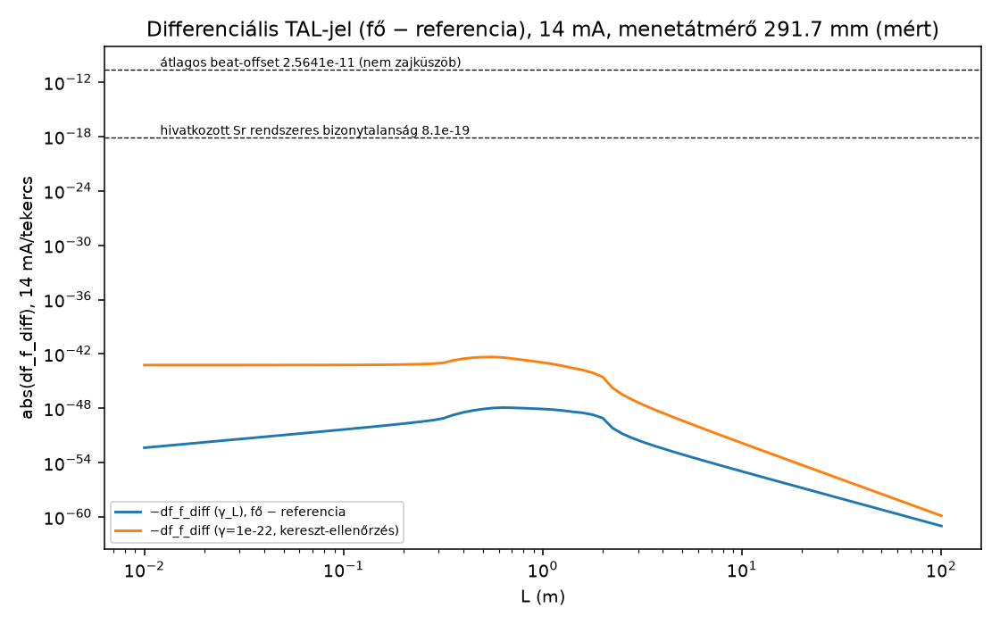

# Végső TAL-előrejelzés – 8 tekercs, OCXO 8663XS, gránitkamra (egyetlen rögzített eset)

**Dátum:** 2026-10-21 (az akadémiai lektori javításokkal). **Hivatkozott rekord (V19):** https://doi.org/10.5281/zenodo.23497128. A „v17” csak fájlnévként szerepel.

**Kötöttségek:** a Zenodo-t, a GitHubot és a repót nem érintettem, a kéziratot nem módosítottam, semmit nem töltöttem fel.

**Címkék:**

- **[SZERZŐ]** = a szerző (Szabolcsi D.) által megadott mért paraméter, 2026-10-21;
- **[TAL]** = a TAL saját törvénye;
- **[STANDARD FIZIKA]** = idézett forrás.

**Előjel:** minden Δf/f a fő óra és a referencia **különbsége**, előjellel: df_f_diff = expm1(−γ·(ρ̄_fő − ρ̄_ref)).

---

## 1. Bemenetek

| Tétel | Érték | Forrás |
|---|---|---|
| Tekercsek | 8 db, függőleges tengely, párhuzamos kapcsolás, mind azonos áramirány; a menetek felfelé haladnak, az óra forgásirányával ellentétesen | [SZERZŐ] |
| Tekercs | hossz 400 mm, tekercstest (perem) Ø 300 mm, menetátmérő 291.7 mm, 2000 menet, 0.15 mm csupasz Cu, műanyag csévetest | [SZERZŐ] |
| Elrendezés | a tekercstest belső széle 0.30 m-en, tengelykör 0.45 m, külső szél 0.60 m. A tekercstestek közti rés 4.4 cm, a menetek közti 5.3 cm | [SZERZŐ] |
| Ellenállás | R = 1789 Ω/tekercs; mind a 8 azonos (menetszám és R tized Ω-ra egyezik) | [SZERZŐ] |
| Áram, táp | I = 14 mA/tekercs; 24 V, 30 Ah BVS akkumulátor; U és I folyamatosan naplózva, 12 h-n át stabil, melegedés nélkül. 14 mA × 1789 Ω = 25.05 V; 24 V / 1789 Ω = 13.4 mA | [SZERZŐ] |
| Naplózás | PicoScope 2205A és Rigol DS1202ZE oszcilloszkóp („NS 200” a szerző korábbi megadása szerint), 12 h folyamatosan | [SZERZŐ] |
| Óra | OCXO 8663XS, 10 MHz, 12 V, SC-vágás, 3. felhang, Micro Crystal / Swatch Group. A helyzete középen, 300 mm-rel a tekercsek alsó síkja felett. A ház hőmérséklete 58–62 °C. Feltételes összevetés: ha az adatlap −20…+70 °C-os üzemi tartománya a házhőmérsékletre vonatkozik, a mért érték ezen belül van; az adatlap ezt nem részletezi | [SZERZŐ] |
| OCXO-paraméterek | stabilitás vs hőmérséklet 4e-9 p-p; öregedés 2e-10/nap; σ(1 s) = 5e-11; fáziszaj −80 / −110 / −135 dBc/Hz (1 / 10 / 100 Hz); kb. 2.5 W | [SZERZŐ] (elsődleges) |
| Lissajous | 360° fordulat 1 h 5 min alatt: Δf = 1/3900 Hz → abs(Δf/f) = 2.5641·10⁻¹¹. Ez **átlagos beat-offset, nem zajküszöb** | [SZERZŐ] |
| Faraday-kapszula (hengeres) | belső üreg Ø 10 cm (r = 0.05 m) × 24 cm. Rétegek kívülről befelé: 10 rétegű, 3 cm-es Al-fólia; 20 m, 1.5 mm-es csupasz Cu-huzal; Al-fólia; Cu-bevonat; szürke hungarocell hüvely (egy darabból öntött üreges test); 1.2 mm-es öntött Al-ház. A rétegek együtt oldalanként 3 cm-esek, így a külső méret Ø 16 cm (r = 0.08 m) × 24 cm. A gránit belső faláig 1 cm rés marad | [SZERZŐ] |
| Gránit | egyenletes hengerhéj: r = 0.09–0.22 m (13 cm fal), magasság 0.50 m, nyitott, az órára centrálva. A vörös magot azonos sűrűséggel kezeltem. Sűrűség 2700 kg/m³ (`Idovonzas_x5f_arxiv.pdf` 2. old., A táblázat). A gránit és a tekercstest között 8 cm van | [SZERZŐ]; [TAL] |
| Referencia-OCXO | teljes iker, azonos kapszulában, azonos magasságban és hőmérsékleten, gránit nélkül. A tekercstest külső felületétől 1 m-re, a fő órától 1.60 m-re van (egy tekercstengely irányában) | [SZERZŐ] |
| Réz | ρ = 1.7241·10⁻⁸ Ω·m, sűrűség 8890 kg/m³ (IEC 60028); folyáshatár 68.9 MPa (C10100, lágyított, copper.org) | [STANDARD FIZIKA] |
| Alumínium | 2700 kg/m³ (CRC Handbook, 100. kiad.) | [STANDARD FIZIKA] |
| TAL | Δf/f = expm1(−γ·Δρ̄_L); ρ_B = B²/(2µ0c²); γ_L = GL²/c²; korlát γ ≤ 10⁻²² (`Time_Attraction.pdf` 3. old.; `Idovonzas_x5f_publikacio.pdf` 2. old. Eq. 15–16) | [TAL] |
| Sr-referenciaóra | σ(1 s) = 4.8·10⁻¹⁷ (Oelker 2019, 10.1038/s41566-019-0493-4); hivatkozott Sr rendszeres bizonytalanság; nem univerzális zajküszöb: 8.1·10⁻¹⁹ (Aeppli 2024, 10.1103/physrevlett.133.023401); kvadratikus Zeeman −23.0 MHz/T² (Lu 2020, 10.3390/app10041440) | [STANDARD FIZIKA] |
| Tér- és energiamodell | véges szolenoid: Derby & Olbert 2010 (10.1119/1.3256157), a mért 291.7 mm-es menetátmérővel. Differenciális térenergia: Gauss–Legendre gömbhéj-integrál közös szögpontokkal, L ≥ 2.6 m-re közvetlen külső különbség (r = L/t); konvergencia: 2.1 pont | [STANDARD FIZIKA] |

### 1.1 Mért és származtatott méretek

| Méret | Érték | Mért / származtatott |
|---|---|---|
| R/tekercs | 1789 Ω | mért [SZERZŐ] |
| I/tekercs; U, I naplózás 12 h | 14 mA | mért [SZERZŐ] |
| menetszám; tekercshossz; huzalátmérő | 2000; 400 mm; 0.15 mm | mért [SZERZŐ] |
| menetátmérő (a térmodellben) | 291.7 mm | mért [SZERZŐ] (1.2 pont) |
| tekercstest-átmérő; belső szél sugara; tengelykör | 300 mm; 0.30 m; 0.45 m (= 0.30 + 0.15) | mért [SZERZŐ]; a tengelykör származtatott. a 300 mm a perem külső mérete (1.2 pont) |
| óra magassága | 300 mm a tekercs-alsósík felett | mért [SZERZŐ] |
| referencia távolsága | 1.60 m (= 0.60 m + 1 m) | [SZERZŐ] 1 m-ből származtatott |
| gránit sugarai, magassága; kapszula méretei | r 0.09–0.22 m, h 0.50 m; Ø 10/16 cm × 24 cm | mért [SZERZŐ] |
| huzalhossz/tekercs | N·π·D = 1832.8 m | származtatott (mért D-ből); ebből R20 = 1788.2 Ω (IEC ρ), a mért 1789 Ω-tól 0.05 %-kal tér el |
| Cu tömeg, 8 tekercs | 2.303 kg | származtatott |
| gránittömeg | 170.9 kg | származtatott (méretek, 2700 kg/m³) |
| Al-ház tömege; 20 m-es Cu-huzal tömege | 0.301 kg; 0.314 kg | származtatott |
| U = I·R | 25.05 V | származtatott |

### 1.2 Mérési jegyzőkönyv – menetátmérő és a 300 mm helye

| Tétel | Érték |
|---|---|
| Mérés dátuma | 2025-11-13 [SZERZŐ] |
| Mérőeszköz – menetátmérő | tolómérő (csúszómérő) [SZERZŐ] |
| Mérőeszköz felbontása | 0.02 mm [SZERZŐ] |
| Jelmérés | Rigol DS1202ZE oszcilloszkóp és PicoScope 2205A [SZERZŐ] |
| Mérést végezte | Szabolcsi Dávid |
| Leolvasások (5 egymást követő, mm) | 291.7; 291.7; 291.7; 291.7; 291.7 [SZERZŐ] |
| Átlag (mm) | 291.7 |
| Szórás (mm) | 0 (mind az 5 leolvasás azonos; felbontás 0.02 mm) |
| A 300 mm helye | a tekercstest külső mérete (perem), nem a menetfelület [SZERZŐ] |

**Geometriai következmény.** A 300 mm a perem külső mérete, ezért a tekercstest belső széle 0.30 m-en, a tengelykör 0.30 + 0.15 = **0.45 m** marad. A referencia a perem külső felületétől (0.60 m) 1 m-re van, vagyis **1.60 m**-re a fő órától; a menetfelülettől ez 1.004 m. A gránit és a perem között 8 cm, a gránit és a menetfelület között 8.42 cm a távolság. A tér a mért 291.7 mm-es menetátmérővel számolva **11.63 µT** a fő órán.

## 2. Eredmény (rögzített eset, 14 mA/tekercs)

| Mennyiség | Érték |
|---|---|
| U / P tekercsenként | 25.05 V / 0.351 W |
| P összesen (8 tekercs), forrásáram | 2.81 W, 0.112 A (12 h alatt 1.34 Ah a 30 Ah-ból) |
| Áramterhelés | a folyamatos (800 W/m²-es) határ (0.405 A) 3.5 %-a; J = 0.79 A/mm² |
| B a tekercsben | 71.1 µT |
| **B a fő órán** | **11.63 µT** (0.8309 mT/A, függőleges) |
| B a referencia-OCXO-n (1.60 m) – kereszt-ellenőrzés | 0.431 µT (30.75 µT/A) |
| Mágneses nyomás a tekercsben | 2.0·10⁻³ Pa (a Cu folyáshatárának 2.9·10⁻¹¹-szerese) |
| **TAL-jel, differenciális (fő − referencia), γ_L, max L szerint (L = 0.63 m)** | **df_f_diff = −1.202·10⁻⁴⁸**; Δt = −1.04·10⁻⁴³ s/nap = −5.19·10⁻⁴⁴ s/12 h |
| Kereszt-ellenőrzés: γ = 10⁻²² (L = 0.56 m) | df_f_diff = −4.63·10⁻⁴³; −4.00·10⁻³⁸ s/nap |
| abs(df_f_diff) / átlagos beat-offset; nem zajküszöb (2.5641·10⁻¹¹) | 4.69·10⁻³⁸ (γ_L); 1.81·10⁻³² (γ = 10⁻²²) |
| abs(df_f_diff) / hivatkozott Sr rendszeres bizonytalanság; nem univerzális zajküszöb (8.1·10⁻¹⁹) | 1.48·10⁻³⁰ |
| Sr AB-átlagolási idő (fehér FM, k = 2) | 1.6·10⁵⁷ év – a választott fehér-FM képlet algebrai extrapolációja, nem tényleges kísérleti időjóslat |
| **Sr kvadratikus Zeeman a fő óra B-jénél** | **−7.25·10⁻¹⁸** (a hivatkozott Sr rendszeres bizonytalanság alatt csak B < 3.9 µT esetén marad) |
| OCXO mágneses csatolási együttható (főóra-egyenérték) | A kvarcnak nincs atomi Zeeman-eltolódása, és az adatlap nem ad mágneses érzékenységet. **Főóra-egyenérték** (a fő óra 11.63 µT-s terére vonatkoztatva): ideális esetben **2.20·10⁻⁶ /T** (lineáris), illetve **0.189 /T²** (kvadratikus) együttható adna az átlagos beat-offsettel azonos nagyságú frekvenciaváltozást |
| Statikus, gránit (csak a fő óra körül) | GR-tag: Φ/c² = −6.28·10⁻²⁵ (fő), −7.92·10⁻²⁶ (referencia), különbség −5.49·10⁻²⁵. TAL: df_f_diff szélső értéke −9.6·10⁻²⁶ (γ_L, L = 0.28 m), −2.1·10⁻¹⁹ (γ = 10⁻²², L = 0.22 m) |
| Statikus, réztekercsek (2.303 kg) | GR-tag: −3.68·10⁻²⁷ (fő), −1.09·10⁻²⁷ (referencia), különbség −2.60·10⁻²⁷. TAL: df_f_diff szélső értéke −6.2·10⁻²⁸ (γ_L), −2.3·10⁻²² (γ = 10⁻²²) |
| Faraday-kapszula | Al-ház: zárt henger, 1.2 mm fal, 1.11·10⁻⁴ m³, 0.301 kg. 20 m-es Cu-huzal: 0.314 kg, r = 0.051–0.080 m sugáron, 40–62 menet. A referencia kapszulája azonos, ezért a differenciális statikus tag 0 (GR és TAL) |
| Az átlagos beat-offsettel azonos nagyságú jelhez szükséges áram tekercsenként | 6.5·10¹⁶ A (γ_L); 1.0·10¹⁴ A (γ = 10⁻²²) |

**Az OCXO-adatok kereszt-ellenőrzése az adatlappal.** Forrás: Oscilloquartz SA, „OCXO 8662/8663 Technical Specification”, Ed. March 2003, `refs/oscilloquartz_8663_ed03-2003.pdf`, 2–3. old. A Micro Crystal 8663XS-adatlapot a microcrystal.com, Mouser, Digi-Key, Farnell, alldatasheet és datasheetarchive oldalakon kerestem, nem található.

| Paraméter | [SZERZŐ] | adatlap |
|---|---|---|
| rövid távú stabilitás | 5e-11 @ 1 s | < 1e-11 (0.2–10 s) |
| fáziszaj 10 MHz, 1 / 10 / 100 Hz | −80 / −110 / −135 dBc/Hz | −90 / −120 / −135 dBc |
| öregedés; stabilitás vs hőmérséklet | 2e-10/nap; 4e-9 p-p | 2e-10/nap; < 4e-9 pp |
| üzemi hőmérséklet | ház 58–62 °C (feltételes összevetés) | −20…+70 °C (üzemi) |
| mágneses érzékenység | – | nincs megadva |

Az adatlap 1e-11-es értékével az arány 1.2·10⁻³⁷.

### 2.1 Numerikus konvergencia

Fájlok: `csv/convergence_dW.csv`, `csv/continuity_test.csv`, `csv/convergence_mc_shared_samples.csv`; kód: `code/energy_integrator.py`.

**Módszer.** ΔW(L) = W_fő(<L) − W_ref(<L).

- A radiális integrál Gauss–Legendre-panelekkel készült (8 pont/panel), radiális interpoláció nélkül.
- Mindkét középpontnál ugyanazon r-en ugyanazokat a szögpontokat használtam: Fibonacci-gömb, a tekercseket metsző 0.25–2.4 m-es tartományban 24 000, máshol 6 000 pont.
- **L ≤ 0.95 m:** belső forma. A referencia-gömbben ilyenkor nincs tekercs.
- **0.95 < L < 2.6 m:** külső különbség, W_ref,ki(L) − W_fő,ki(L). A panelek L-től 3 m-ig tartanak, utána r = 3/t farok következik.
- **L ≥ 2.6 m:** közvetlen külső különbség r = L/t helyettesítéssel (t ∈ (0, 1], 32 pontos Gauss–Legendre), levágás és interpoláció nélkül.
- A külső formában nem szerepel teljes energia. A korábbi 0.01268 J/A²-es eltolás így eltűnt.
- A két középpont körüli teljes energia: 2.23786 J/A² (fő) és 2.23645 J/A² (referencia). Az eltérés 1.4·10⁻³ J/A² (0.06 %). Ez a referencia körüli, tekercseket metsző gömbhéjak szögkvadratúra-hibája. Csak a 0.95–2.4 m-es tartományt érinti. L = 0.95 m-nél a belső és a külső forma 2.17738947, illetve 2.17597607 J/A²; az illesztési hiba 0.00141340 J/A² (a belső érték 0.0649 %-a). A ΔW(L) görbe ezért nem folytonos gépi pontossággal; a gépi pontosságú egyezés csak a 2.6–3.01 m-es A/B átfedésre vonatkozik.

**Folytonosság (`csv/continuity_test.csv`).**

- L = 2.99 / 3.00 / 3.01 m-nél az A út (panelek + farok) és a B út (r = L/t) relatív eltérése 0 / −7.4·10⁻¹⁶ / −1.5·10⁻¹⁵.
- A 2.6–2.9 m-es átfedési tartományban ≤ 2.9·10⁻¹⁵.

**Konvergencia.** Négy futás: a tekercseket metsző héjakon 6 000 / 12 000 / 24 000 szögponttal, valamint 12 000 szögponttal kétszeres radiális panelsűrűséggel. A **szórás** itt a 4 futás eredményeinek **mintaszórása**: s = √(Σ(x_i − x̄)²/(n − 1)), n = 4.

| L (m) | teljes tartomány (J/A²) | mintaszórás s (J/A²) | s/átlag |
|---|---|---|---|
| 0.316 | 0.0637725–0.0637856 | 6.9·10⁻⁶ | 1.1·10⁻⁴ |
| 0.631 (maximum) | 1.96091–1.96135 | 2.1·10⁻⁴ | 1.1·10⁻⁴ |
| 1.0 | 2.17526–2.18903 | 6.5·10⁻³ | 3.0·10⁻³ |
| 2.0 | 0.426248–0.431987 | 2.8·10⁻³ | 6.6·10⁻³ |
| 2.6; 3.16; 10; 31.6; 100 | 7.13721·10⁻³; 1.62106·10⁻³; 2.77763·10⁻⁶; 8.37811·10⁻⁹; 2.6365·10⁻¹¹ (mind a 4 futásban azonos) | 0* | 0* |

\* A négy futás ebben a tartományban azonos nlo és nt beállítást használ. A nulla mintaszórás ezért nem távoli hibabecslés; a távoli konvergenciát nlo és nt külön változtatásával kell vizsgálni.

**Független ellenőrzés közös térfogati Monte Carlo-mintákkal** (1.5·10⁶ pont; a két gömb-indikátorfüggvény különbsége, a térenergiával súlyozva). A relatív MC-hibák (σ/ΔW):

- L = 0.316 m: 2.17 % (eltérés −1.86σ);
- L = 0.631 m: 0.99 % (+0.61σ);
- L = 1.0 m: 1.14 % (+0.92σ);
- L = 2.0 m: 4.04 % (−0.02σ).

ΔW(L) minden vizsgált L-nél pozitív. Negatív nagy L-ű farok nem lép fel.

## 3. Megvalósíthatóság nagyobb árammal (a szerző listája)

| I/tekercs | U = I·R | P, 8 tekercs | 24 V-os akku / 30 V–3 A-es táp | Onderdonk-féle olvadási idő (adiabatikus) | I / folyamatos határ | B a fő órán | B²/2µ0 | df_f_diff γ_L | df_f_diff γ = 10⁻²² | Sr Zeeman |
|---|---|---|---|---|---|---|---|---|---|---|
| 1.5 A | 2684 V | 32.2 kW | nem / nem | 11.7 s | 3.7 | 1.25 mT | 23.1 Pa | −1.38·10⁻⁴⁴ | −5.32·10⁻³⁹ | −8.3·10⁻¹⁴ |
| 2 A | 3578 V | 57.2 kW | nem / nem | 6.6 s | 4.9 | 1.66 mT | 41.0 Pa | −2.45·10⁻⁴⁴ | −9.45·10⁻³⁹ | −1.5·10⁻¹³ |
| 3 A | 5367 V | 128.8 kW | nem / nem | 2.9 s | 7.4 | 2.49 mT | 92.3 Pa | −5.52·10⁻⁴⁴ | −2.13·10⁻³⁸ | −3.3·10⁻¹³ |

- Mindhárom áram a Preece-féle 4.65 A-es (szabad levegőn mért) fúziós határ alatt van, de a folyamatos határ (0.405 A) felett.
- Az Onderdonk-becslés csak idealizált adiabatikus olvadási idő. Ebből biztonságos impulzushossz nem állapítható meg; a számított nagyáramú esetek nem üzemeltetési javaslatok.

## 4. Mérési sorozat

1. **Alapvonal.** 12 h tekercsek nélkül (I = 0). A PicoScope naplózza a két OCXO Lissajous-fázisát, és mellette az akkumulátor U-ját és I-jét, valamint a házhőmérsékletet.
2. **Be/ki ciklusok.** A 14 mA-es áramot egyenlő hosszú szakaszokban kapcsoljuk be és ki (65 perces félperiódusokkal, a megfigyelt beat-periódushoz igazítva) legalább 12 h-n át. Minden szakaszban rögzítjük a fázis meredekségét, ebből adódik a df_f_diff.
3. **Polaritásváltás.** Ugyanez a ciklus fordított áramiránnyal. A B-ben lineáris hatás előjelet vált, a B²-tel arányos (TAL- és kvadratikus) hatás nem. A tiszta tekercs-B² tag páros a polaritásra. Állandó háttértérben az energiasűrűség-változásnak 2B_bg·B_coil kereszttagja is van; ezt az azonos nagyságú ±I állapotok OFF-hoz viszonyított átlaga ideális esetben törli. A közölt −1.20×10⁻⁴⁸ érték erre az izolált páros tagra vonatkozik, nem minden lehetséges egyszerű ON/OFF mérés teljes előrejelzése.
4. **Kiértékelés.** Képezzük a be − ki különbséget és bizonytalanságát, valamint a polaritásváltás összegét és különbségét. Közben elkülönítjük a hőmérsékleti és tápcsatolást. A TAL-előrejelzés ebben a sorozatban −1.202·10⁻⁴⁸.
5. **Azonos hőterhelésű kontroll.** A Joule-hő is páros az áramban, ezért a polaritásváltás nem választja le; azonos hőterhelésű kontroll és a hőmérséklet-beállás naplózása szükséges. A kikapcsolt szakaszokban ugyanakkora hőterhelést (2.81 W) kell leadni egy mágneses teret nem keltő (bifiláris) ellenálláson, a tekercsek közelében. Az azonos összteljesítményű, kis maradékterű kontroll célja a kapcsolással korrelált termikus változás csökkentése. A be- és kikapcsolt állapotok hőmérsékleti azonosságát és a kontroll maradékterét méréssel ellenőrizni kell; a maradék eltérést a frekvenciabecslés bizonytalanságába kell foglalni. Minden átkapcsolás után a házhőmérsékletet, a gránitot és a környezetet a hőmérséklet beállásáig naplózni kell. A kiértékelésbe csak a beállás utáni szakaszok kerülnek.

## 5. Ítélet

- A rögzített elrendezésben az izolált, polaritásra páros tekercs-B² tag számított differenciális TAL-jele **−1.202·10⁻⁴⁸** (γ_L), illetve −4.63·10⁻⁴³ (γ = 10⁻²²). Ez a megfigyelt átlagos beat-offset (2.5641·10⁻¹¹, nem zajküszöb) 4.7·10⁻³⁸-szorosa, illetve 1.8·10⁻³²-szerese.
- **A jel az OCXO-párral nem mérhető, és Sr-referenciaórával sem** (a hivatkozott Sr rendszeres bizonytalanság 1.5·10⁻³⁰-szorosa; a fehér-FM képlet algebrai extrapolációja 1.6·10⁵⁷ év, nem tényleges kísérleti időjóslat).
- A 1.5–3 A-es áramokhoz kV-os táp kellene, a huzal pedig másodpercek alatt megolvadna. Még ekkor is ≤ 5.5·10⁻⁴⁴ a jel.
- A gránit (−5.5·10⁻²⁵ GR-ben; −9.6·10⁻²⁶ TAL-ban) és a réz statikus ofszetet ad, nem modulált jelet.
- Az idézett csatolási együttható (főóra-egyenérték: 2.20·10⁻⁶ /T; 0.189 /T²) csak azt mutatja, mekkora ideális mágneses frekvenciaváltozás lenne azonos nagyságú a megfigyelt átlagos beat-offsettel. Mért be/ki bizonytalanság és a környezeti csatolások elkülönítése nélkül ebből felső korlát nem adható.

## 6. Nem számolható

1. **Műanyag csévetest tömege és anyaga.** Anyagvizsgálat nincs, ezért a tekercsek csévetestének statikus differenciális tömegtagja nem számolható. Szükséges bemenet: tömeg (kg/tekercs) és sűrűség (kg/m³).

## 7. Fájlok

- `code/final_fixed.py` – a teljes számítás
- `code/fields.py` – Derby & Olbert 2010; SHA azonos a `solenoid_update`-ével
- `code/tophat_finite_source.py`, `code/build_pdf.py`
- `csv/fixed_case_and_feasibility.csv`, `csv/fixed_case_numbers.json`, `csv/derived_from_R1789.csv`
- `code/energy_integrator.py`
- `csv/tal_differential_vs_L.csv`, `csv/convergence_dW.csv`, `csv/continuity_test.csv`, `csv/convergence_mc_shared_samples.csv`
- `csv/granite_static_differential.csv`, `csv/copper_coils_static_differential.csv`
- `plots/fixed_signal_vs_L.png`
- `refs/oscilloquartz_8663_ed03-2003.pdf`

